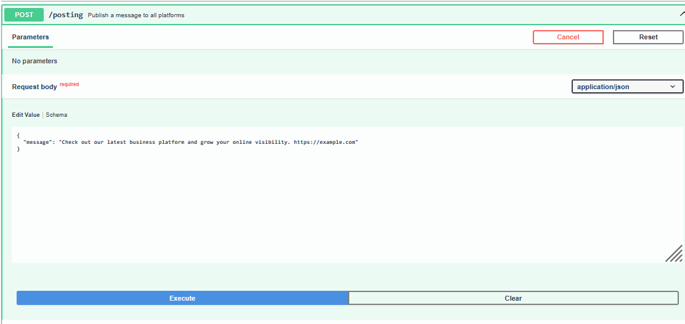
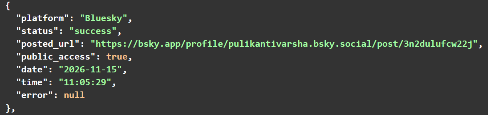
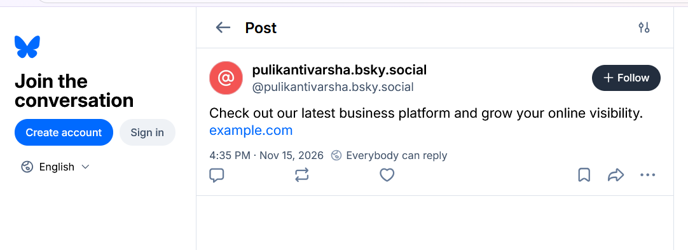

# Automated Multi-Platform Posting System

A FastAPI service that takes one short message (max 200 chars, exactly one CTA link) and publishes it to
five third-party platforms through their official APIs. Each platform is isolated: if one fails, the rest still post.

## Platforms

| Platform | API used | Credentials |
|---|---|---|
| Mastodon | `POST /api/v1/statuses` | Access token (`write:statuses`) |
| Bluesky | AT Protocol `createSession` + `createRecord` | Handle + App Password |
| Telegram | Bot API `sendMessage` (public channel) | Bot token + channel `@username` |
| DEV Community | Forem `POST /api/articles` | API key |
| Telegraph | `createAccount` + `createPage` | None (anonymous account is auto-created) |

## Setup

**Windows (PowerShell)**

```powershell
python -m venv .venv
.venv\Scripts\Activate.ps1
pip install -r requirements.txt
copy .env.example .env        # then fill in your credentials
uvicorn app.main:app --host 0.0.0.0 --port 4000
```

**macOS / Linux**

```bash
python -m venv .venv
source .venv/bin/activate
pip install -r requirements.txt
cp .env.example .env          # then fill in your credentials
uvicorn app.main:app --host 0.0.0.0 --port 4000
```

Swagger UI: http://localhost:4000/docs

Platforms without credentials are reported as `failed` ("Credentials not configured"). The API itself never crashes.

## Usage

```bash
curl -X POST http://localhost:4000/posting \
  -H "Content-Type: application/json" \
  -d '{"message": "Check out our latest business platform and grow your online visibility. https://example.com"}'
```

### Example response

Illustrative output when all five platforms are configured. Handles and IDs are placeholders.

```json
{
  "success": true,
  "results": [
    {
      "platform": "Mastodon",
      "status": "success",
      "posted_url": "https://mastodon.social/@yourhandle/115000000000000000",
      "public_access": true,
      "date": "2026-11-15",
      "time": "11:05:29",
      "error": null
    },
    {
      "platform": "Bluesky",
      "status": "success",
      "posted_url": "https://bsky.app/profile/yourhandle.bsky.social/post/3n2dulufcw22j",
      "public_access": true,
      "date": "2026-11-15",
      "time": "11:05:29",
      "error": null
    },
    {
      "platform": "Telegram",
      "status": "success",
      "posted_url": "https://t.me/your_channel/42",
      "public_access": true,
      "date": "2026-11-15",
      "time": "11:05:29",
      "error": null
    },
    {
      "platform": "DEV Community",
      "status": "success",
      "posted_url": "https://dev.to/yourhandle/check-out-our-latest-business-platform-and-grow-your-onli-1a2b",
      "public_access": true,
      "date": "2026-11-15",
      "time": "11:05:30",
      "error": null
    },
    {
      "platform": "Telegraph",
      "status": "success",
      "posted_url": "https://telegra.ph/Check-out-our-latest-business-platform-and-grow-your-onli-11-15-2",
      "public_access": true,
      "date": "2026-11-15",
      "time": "11:05:29",
      "error": null
    }
  ]
}
```

`success` is `true` when at least one platform succeeded. Date/time are UTC.
A platform that fails returns `"status": "failed"`, `"posted_url": null` and an `error` message, and the other platforms are not affected.

### Validation error (HTTP 422)

Request: `{"message": "Two https://a.com https://b.org"}`

```json
{
  "detail": [
    {
      "type": "value_error",
      "loc": ["body", "message"],
      "msg": "Value error, Message must contain exactly one CTA link (found 2)."
    }
  ]
}
```

Validation rules: non-empty, <= 200 characters, exactly one `http(s)` link, link must have a valid hostname.

## Project structure

```
app/
  main.py                  FastAPI app, POST /posting
  schemas.py               Pydantic models + validation
  config.py                Environment variable loading
  platforms/
    base.py                Platform interface + HTTP error handling
    mastodon.py bluesky.py telegram.py devto.py telegraph.py
  services/posting_service.py   Concurrent posting with per-platform isolation
tests/test_posting.py      Validation + failure-isolation tests
```

## Design notes

- **Isolation:** `asyncio.gather` runs all platforms concurrently; every platform call is wrapped so any exception
  (timeout, auth, bug) becomes a `failed` result for that platform only.
- **Extensible:** add a class implementing `Platform` and register it in `app/platforms/__init__.py`.
- **Secrets:** read from environment only; `.env` is git-ignored.

## Tests

```bash
pytest -q
```

## Screenshots

### Request


### Response


### Live post on Bluesky

